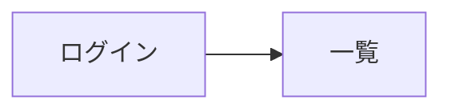

# 基本設計書: {案件名}

| 項目 | 内容 |
|---|---|
| ステータス | 作成中 / レビュー済み / 承認済み |
| 版 | 1.0 |
| 入力 | docs/projects/{案件名}/requirements.md |

## 1. 機能一覧

| 機能 ID | 機能名 | 対応ユースケース | 概要 | 分割の理由 |
|---|---|---|---|---|
| {略号}-001 | | UC-01 | | |

## 2. 画面設計

### 2.1 画面一覧

| 画面 ID | 画面名 | パス | 機能 ID | 利用ロール |
|---|---|---|---|---|

### 2.2 画面遷移

### 2.3 画面ごとの主な項目と操作

## 3. API 設計

| 機能 ID | メソッド | パス | operationId | 認可ロール | 概要 |
|---|---|---|---|---|---|

## 4. テーブル設計

### 4.1 テーブル一覧

| テーブル | 概要 | 主な制約 |
|---|---|---|
| app.{テーブル} | | |

### 4.2 テーブル定義

| カラム | 型 | NULL | 制約・既定値 | 説明 |
|---|---|---|---|---|

## 5. 権限設計

| 機能 ID | 参照 | 登録 | 更新 | 削除 |
|---|---|---|---|---|
| | ADMIN, VIEWER | ADMIN | ADMIN | ADMIN |

## 6. 業務ルールの実現方式

| ルール ID | 実現場所（API 制約 / ドメイン / DB / 画面） | エラー時の応答 |
|---|---|---|

## 7. 基盤部品の利用・拡張

## 8. 未確定事項・前提

## 9. 変更履歴

| 版 | 日付 | 内容 |
|---|---|---|
