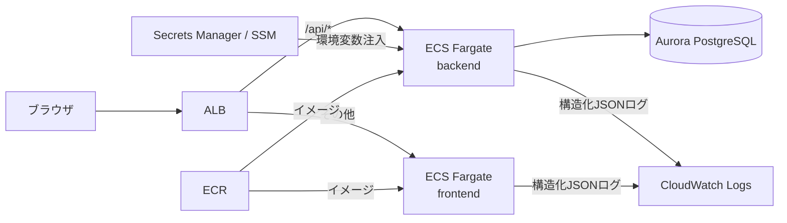

# 方式設計書

本書は本プロジェクトの **SSoT（Single Source of Truth）** である。
設計・実装・レビューの全工程はこの方式設計に準拠すること。本書と実装が乖離した場合は、本書を先に改訂してから実装を変更する（仕様駆動開発）。

## 1. システム構成

### 1.1 実行基盤（AWS）



- backend（Spring Boot）と frontend（Next.js）を別々の **ECS Fargate サービス**として動かし、ALB のパスルーティングで同一オリジンに見せる（本番では CORS 不要）
- 機密情報（DB 接続情報・JWT 署名鍵）は Secrets Manager / SSM Parameter Store から環境変数として注入する。コード・設定ファイルへの直書きは禁止
- ローカル開発は AWS 非依存で動く（Docker Compose の PostgreSQL、`local` プロファイル）

### 1.2 アプリケーション構成

- backend は1つの実行可能 Jar（コンテナイメージは Jib で作る）。機能の追加＝パッケージの追加であり、インフラ構成の変更を伴わない
- frontend は Next.js の App Router。API は backend の REST API だけを使い、Next.js の Route Handler に業務ロジックを置かない
- **API 定義（`backend/web-sample/src/main/resources/api/openapi.yaml`）が backend と frontend の契約**であり、両側のコードはここから生成する（§3）

## 2. モジュール構成

| モジュール | 役割 | 依存 |
|---|---|---|
| `backend/web-core` | backend 基盤部品。業務に依存しない | Spring Web MVC / Security / Validation / jjwt |
| `backend/web-sample` | 業務アプリケーション（サンプル）。API 実装と業務ロジック | `web-core` |
| `frontend/src/core` | frontend 基盤（API クライアント・認証・i18n・共通 UI）。業務に依存しない | — |
| `frontend/src/features/{機能}` | 業務機能ごとの画面部品・フック・入力検証 | `core` |

**原則: 業務コードは基盤部品を必ず利用する。** 基盤にある機能（認証・エラー応答・ページング・API クライアント・共通 UI 等）を業務側で独自実装してはならない。不足があれば基盤を拡張する。

### 2.1 backend のパッケージ構成（業務モジュール）

機能単位のパッケージに、レイヤ別のサブパッケージを置く（パッケージ・バイ・フィーチャー）。

```
com.example.web.sample/
├── WebSampleApplication.java     # @SpringBootApplication + @EnableWebCore
├── generated/                    # OpenAPI から生成（コミットしない。target/ に出力）
├── auth/                         # 認証機能（案件でもそのまま使う）
└── message/                      # サンプル業務機能（案件では差し替える）
    ├── presentation/             # Controller（生成インタフェースを実装）
    ├── application/              # ユースケース（1操作1クラス。トランザクション境界）
    ├── domain/                   # ドメインモデル（record）・リポジトリIF・業務例外
    └── infrastructure/           # リポジトリ実装・MyBatis Mapper
```

依存の向きは `presentation → application → domain ← infrastructure`。次を ArchUnit（`ArchitectureTest`）で機械的に検査する。

- domain は他のレイヤ・生成コードに依存しない
- application は infrastructure・presentation・生成コードに依存しない
- 生成コード（`generated`）は presentation からだけ使う
- 機能パッケージどうしは依存しない（共通化が必要なら web-core へ）

### 2.2 frontend のディレクトリ構成

```
frontend/src/
├── app/                          # ルーティング（ページは features の部品を組み立てるだけ）
├── core/
│   ├── api/                      # axios クライアント・QueryClient・Orval 生成コード（generated/）
│   ├── auth/                     # 認証コンテキスト・ロール判定・RoleBasedComponent
│   ├── i18n/                     # next-intl 設定・言語切替
│   ├── components/               # 共通部品（ui/ は shadcn/ui）
│   ├── hooks/                    # 共通フック（API エラー処理など）
│   └── lib/                      # ユーティリティ
└── features/{機能}/
    ├── components/               # 機能の画面部品
    ├── hooks/                    # 機能のデータ取得・更新フック（生成フックをラップ）
    ├── validations.ts            # 入力検証（zod）
    └── query-keys.ts             # TanStack Query のキー
```

- `features` どうしは import しない。複数機能で使うものは `core` へ移す
- 表示文言は `frontend/messages/{ja,en}.json` に置き、コンポーネントに直書きしない

## 3. API 設計方針

### 3.1 API 定義ファースト

1. API の追加・変更は **`openapi.yaml` を先に変更する**（詳細設計で確定させる）
2. backend: `./mvnw compile` で Controller インタフェースとモデルを生成し（`generated` パッケージ）、Controller が実装する
3. frontend: `pnpm generate:api` で API クライアント・TanStack Query フック・モックを生成し、コミットする（CI が定義との一致を検査する）

### 3.2 規約

| 項目 | 規約 |
|---|---|
| パス | `/api/{リソース複数形}`、`/api/{リソース}/{id}`。動詞を入れない |
| メソッド | 取得 GET / 登録 POST（201＋`Location`）/ 更新 PUT / 削除 DELETE（204） |
| operationId | camelCase の動詞＋名詞（`getAllMessages`・`createMessage`）。生成コードのメソッド名になる |
| tags | 機能単位（生成インタフェース・frontend のファイル分割単位になる） |
| 入力検証 | 単項目チェック（必須・長さ・形式・範囲）は OpenAPI の制約で書く（Bean Validation に生成される） |
| ページング | クエリ `page`（0始まり）・`size`（上限100）。応答は `{content: [...], page: {size, number, totalElements, totalPages}}` |
| 日時 | ISO 8601（`date-time`）。DB は `TIMESTAMPTZ` |
| エラー | すべて `application/problem+json`（§5.2） |
| 認証 | 既定で全 API が Bearer 認証必須。不要な API だけ `security: []` と `app.security.public-paths` に追加 |

## 4. 認証・認可

- **JWT によるステートレス認証**（web-core）。ログインでアクセストークン（既定1時間）とリフレッシュトークン（既定7日）を発行する
- トークンには種別クレーム（`typ`: ACCESS / REFRESH）を入れ、**アクセストークンだけを API 認証に使う**（取り違えを防ぐ）
- リフレッシュトークンは保管庫（`RefreshTokenStore`）で管理し、再発行のたびに**ローテーション**（旧トークンを破棄）する。ログアウトで破棄する
  - 既定の保管庫はメモリ保持。**複数タスクで運用する場合は DB/Redis 実装に差し替える**
- 認可はロール（`ADMIN`・`VIEWER`）で行い、Controller の `@PreAuthorize` に書く。frontend の表示制御（`RoleBasedComponent`）は利便性のためであり、**認可の根拠にしない**
- パスワードは BCrypt でハッシュ化する。ログイン失敗時に「ユーザーが存在しない」と「パスワード誤り」を区別しない
- CSRF 対策は無効（認証情報を Cookie でなく Authorization ヘッダで送るため）。トークンを localStorage に置くため、**XSS 対策（`dangerouslySetInnerHTML` 禁止・依存の脆弱性管理）を徹底する**

## 5. エラー処理方針

### 5.1 例外階層（web-core で定義）

| 例外 | 意味 | HTTP |
|---|---|---|
| `ResourceNotFoundException` | 対象が存在しない | 404 |
| `ResourceConflictException` | 一意制約違反など状態の競合 | 409 |
| `InvalidInputException` | 単項目チェックで表せない入力不正（ドメインの不変条件違反） | 400 |
| `SystemException` | 環境・外部要因のエラー | 500 |

- 業務機能では上記のサブクラスを定義して送出する（例: `MessageNotFoundException extends ResourceNotFoundException`）。`RuntimeException` を直接送出しない
- Controller・ユースケースで try-catch してエラー応答を組み立てない。変換は `GlobalExceptionHandler` に一元化する
- 同時実行で事前チェックをすり抜ける一意制約違反は、リポジトリ実装で `DuplicateKeyException` を業務例外に変換する

### 5.2 エラー応答（RFC 9457 Problem Details）

```json
{"type": "https://api.example.com/errors/validation-error", "title": "Bad Request", "status": 400,
 "detail": "入力内容に誤りがあります。", "instance": "/api/messages", "timestamp": "2026-01-01T00:00:00Z",
 "errors": [{"field": "code", "rejectedValue": "", "message": "..."}]}
```

| type 末尾 | 状況 | HTTP |
|---|---|---|
| `validation-error` | 項目チェック違反（`errors` に項目ごとの内容） | 400 |
| `invalid-input` / `malformed-request` | 業務上の入力不正 / 解析できないリクエスト | 400 |
| `unauthorized` | 未認証・認証失敗 | 401 |
| `forbidden` | 権限不足 | 403 |
| `not-found` / `conflict` | 業務例外 | 404 / 409 |
| `http-{status}` | Spring MVC の標準エラー（存在しないパス・未対応メソッド等） | 各ステータス |
| `internal-error` | 想定外のエラー（詳細はログにだけ出す） | 500 |

### 5.3 frontend のエラー表示

- 401 は API クライアント（`core/api/client.ts`）がトークン再発行を1回試み、失敗したらログイン画面へ遷移する
- それ以外の API エラーは `core/hooks/useApiError` で利用者向けの文言（`messages/*.json`）に変換して表示する
- 項目チェックは送信前にフォーム側（zod）で行い、API と同じ制約を `features/{機能}/validations.ts` に書く

## 6. トランザクション方針

- トランザクション境界は**ユースケース（application 層）**。更新系に `@Transactional`、参照系に `@Transactional(readOnly = true)` を付ける
- 1ユースケース＝1トランザクション。Controller・リポジトリで境界を作らない
- 外部 API 呼出をトランザクション内で行わない（ロック長期化を防ぐ）

## 7. データベース方針

### 7.1 スキーマ・マイグレーション

- 業務テーブルは **`app` スキーマ**に置き、SQL は必ずスキーマ修飾する（`app.messages`）。`currentSchema` は指定しない
- Flyway で管理する。`db/migration/V{連番}__{内容}.sql`。**適用済みファイルは変更しない**（新しい V ファイルを追加する）
- ローカル・E2E 用の初期データは `db/local/R__*.sql` に置き、`local` プロファイルでだけ適用する（本番に入れない）
- 主キーは `BIGINT GENERATED ALWAYS AS IDENTITY`、日時は `TIMESTAMPTZ`

### 7.2 DB アクセス

- MyBatis を標準とする。SQL は Mapper XML（`src/main/resources/mapper/`）に書き、アノテーション SQL は使わない
- 結果は record にマッピングする（`arg-name-based-constructor-auto-mapping`）。採番値は `RETURNING` で受け取る
- 一覧取得は必ずページングし（`LIMIT/OFFSET`）、ソート順を一意に決める（`ORDER BY created_at DESC, id DESC`）
- ループ内で1件ずつ SQL を発行しない（N+1 を避ける）。ソート項目を利用者入力から組み立てない（SQL インジェクション対策）

## 8. ロギング・監視方針

- `prod` プロファイルは**構造化 JSON**（Spring Boot structured logging、ECS 形式）で標準出力へ出し、CloudWatch Logs へ送る。`local` はテキスト形式
- 利用者が制御できる値は `LogSanitizer.sanitize()` を通してからログに出す（ログインジェクション対策）
- ログレベル: 業務エラー=INFO、認証・認可・リクエストエラー=WARN、想定外のエラー=ERROR（スタックトレース付き）
- 個人情報・パスワード・トークンをログに出さない
- ヘルスチェックは `/actuator/health`（ALB のターゲットグループで使う）

## 9. 設定管理

| プロファイル | 用途 | DB・署名鍵 |
|---|---|---|
| （なし） | 共通設定（`application.yml`） | 環境変数（`DB_URL`・`DB_USERNAME`・`DB_PASSWORD`・`JWT_SECRET`） |
| `local` | ローカル開発・E2E | docker compose の固定値、初期データ投入 |
| `test` | 結合テスト | Testcontainers（`@ServiceConnection`） |
| `prod` | 本番 | Secrets Manager から環境変数で注入 |

- 業務設定は `@ConfigurationProperties`（record）で受ける。web-core の設定は `app.security.*`・`app.error.*`
- frontend の環境変数は `NEXT_PUBLIC_API_URL` のみ（ビルド時に埋め込まれる。本番は同一オリジンのため空）

## 10. 命名規約

| 対象 | 規約 | 例 |
|---|---|---|
| 機能 ID（設計書） | `{案件略号}-{連番3桁}` | `ORDER-001` |
| backend 機能パッケージ | 英小文字の単数名詞 | `com.example.web.sample.message` |
| ユースケース | `{動詞}{対象}UseCase` | `CreateMessageUseCase` |
| 業務例外 | `{対象}{状況}Exception` | `MessageNotFoundException` |
| Controller | `{機能}Controller implements {タグ}Api` | `MessageController` |
| Mapper / XML | `{エンティティ}Mapper` / `mapper/{エンティティ}Mapper.xml` | `MessageMapper.xml` |
| テーブル・カラム | snake_case、テーブル名は複数形 | `app.messages`・`created_at` |
| Flyway | `V{連番}__{内容}.sql`（内容は英語 snake_case） | `V3__create_orders.sql` |
| frontend 機能ディレクトリ | 英小文字の複数形 | `features/messages` |
| コンポーネント / フック | PascalCase / `use` + PascalCase、名前付き export | `MessageTable.tsx` / `useMessageMutations.ts` |
| テスト ID | `data-testid` は kebab-case で機能名を含める | `message-modal`・`create-message-button` |

## 11. テスト方針

| レベル | 対象 | 手段 | 置き場所 |
|---|---|---|---|
| backend 単体 | ドメイン・ユースケース・部品 | JUnit 5 + Mockito（Spring コンテキスト非使用） | `*Test.java` |
| backend 結合 | API（Controller〜DB） | `@SpringBootTest` + MockMvc + Testcontainers（PostgreSQL 16） | `*IT.java` |
| アーキテクチャ | レイヤ・機能間の依存 | ArchUnit | `ArchitectureTest` |
| frontend 単体・コンポーネント | フック・検証・コンポーネント | Vitest + Testing Library + MSW | `tests/unit`・`tests/component` |
| frontend カタログ | コンポーネントの表示状態 | Storybook + Vitest | `*.stories.tsx` |
| E2E | 画面からの業務シナリオ | Playwright（実 backend） | `frontend/tests/e2e` |

- backend のカバレッジ閾値: 命令カバレッジ 80%（JaCoCo、単体＋結合の合算）。frontend: lines/statements/functions 80%・branches 70%（Vitest）
- 結合テストは API を実際に呼び、ステータス・応答本文・DB の結果を検証する。テストデータは各テストが自前で用意する
- E2E は重要な業務シナリオと権限の違いに絞る（項目チェックの網羅は単体・結合で行う）

## 12. 実装上の注意（Spring Boot 4 / Next.js 16）

- **Web 上の Spring Boot 3 以前のサンプルを流用しない。** 主な違い:
  - Jackson 3（パッケージ `tools.jackson.*`。アノテーションは `com.fasterxml.jackson.annotation` のまま）
  - スターター名 `spring-boot-starter-webmvc`、テスト用 `spring-boot-starter-webmvc-test`（`@AutoConfigureMockMvc` は `org.springframework.boot.webmvc.test.autoconfigure`）
  - Flyway の自動構成は `spring-boot-starter-flyway` が必要
  - Testcontainers 2 系（`org.testcontainers.postgresql.PostgreSQLContainer`、アーティファクト `testcontainers-postgresql`）
- 生成 Controller インタフェースには `@Validated` を付けない（`useSpringBuiltInValidation`）。付けるとパラメータ検証が AOP になり例外の型が変わる
- Next.js 16 は API・規約が変わっている。実装前に `frontend/node_modules/next/dist/docs/` を確認する（`frontend/AGENTS.md`）
