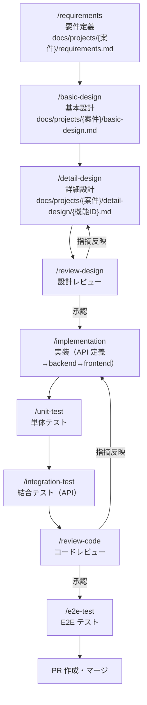

# 開発ガイド

本書は、この雛形を使って案件開発を進めるための手順書である。
開発は Claude Code と工程別 Skills（`.claude/skills/`）を用いた **SDD（仕様駆動開発）** で進める。

## 1. 環境構築

### 1.1 前提ツール

| ツール | バージョン | 備考 |
|---|---|---|
| JDK | 25（Temurin） | `java -version` で確認 |
| Node.js / pnpm | 24 / 9 | `corepack enable` または `npm i -g pnpm@9` |
| Docker | 最新 | 結合テスト・ローカル DB で必須 |
| Git / GitHub CLI | 最新 | `gh auth login` 済みであること |
| Claude Code | 最新 | 標準開発環境 |

Maven はリポジトリ同梱の Maven Wrapper（`backend/mvnw`）を使うためインストール不要。

### 1.2 初回セットアップ

```bash
git clone https://github.com/nagashima-toru/spring-web-ai-coding-samples.git
cd spring-web-ai-coding-samples

docker compose -f docker/compose.yaml up -d          # ローカル DB（PostgreSQL 16）
(cd backend && ./mvnw clean verify)                  # backend のビルド＋全テスト
(cd frontend && pnpm install && pnpm test --run)     # frontend の依存とテスト（pre-commit フックも有効になる）
```

### 1.3 起動と動作確認

```bash
# backend（local プロファイル: 初期ユーザー admin/admin123・viewer/viewer123 を投入）
cd backend && ./mvnw -q package -DskipTests && java -jar web-sample/target/web-sample-*.jar --spring.profiles.active=local

# frontend（別ターミナル）
cd frontend && pnpm dev   # http://localhost:3000
```

### 1.4 よく使うコマンド

```bash
# backend（backend/ で実行）
./mvnw clean verify                                          # 単体＋結合（Docker 必須）＋静的解析＋カバレッジ80%
./mvnw clean verify -DskipITs -Djacoco.haltOnFailure=false   # 結合テストを除外（Docker 不要）。カバレッジ不足では止めない
./mvnw clean verify -DskipITs -pl web-core                   # web-core のカバレッジ80%を判定
./mvnw test -pl web-sample -Dtest=MessageTest                # テストを絞って実行

# frontend（frontend/ で実行）
pnpm generate:api                       # openapi.yaml から API クライアントを再生成
pnpm lint && pnpm format:check && pnpm type-check
pnpm test:coverage                      # 単体・コンポーネントテスト（カバレッジ閾値つき）
pnpm test:storybook                     # Storybook のテスト
pnpm build                              # 本番ビルド
pnpm test:e2e                           # E2E（backend を local プロファイルで起動してから）
```

### 1.5 クラウド環境での準備

Claude Code on the web などのクラウド環境では、JDK 25 と Docker デーモンが既定で用意されないことがある。環境の setup script かセッションの最初に次を実行する。

```bash
#!/usr/bin/env bash
set -euo pipefail
# JDK 25（apt で入らない環境では Temurin のアーカイブを展開する）
if ! ls /usr/lib/jvm/java-25-openjdk-* >/dev/null 2>&1; then
  apt-get update -qq && DEBIAN_FRONTEND=noninteractive apt-get install -y -qq openjdk-25-jdk-headless
fi
# ./mvnw は ~/.mavenrc の JAVA_HOME を使う（PATH の java が 25 でなくてもよい）
printf 'JAVA_HOME=%s\nexport JAVA_HOME\n' "$(ls -d /usr/lib/jvm/java-25-openjdk-* | head -1)" > ~/.mavenrc
if ! docker info >/dev/null 2>&1; then
  nohup dockerd >/tmp/dockerd.log 2>&1 &
  for _ in $(seq 1 30); do docker info >/dev/null 2>&1 && break; sleep 1; done
fi
```

Maven Central がレート制限（HTTP 429）を返す環境では、`~/.m2/settings.xml` にミラー
（例: `https://maven-central.storage-download.googleapis.com/maven2`）を設定し、
`MVNW_REPOURL` に同じ URL を設定する（リポジトリにはコミットしない）。

## 2. 開発の進め方（工程と Skills）

各工程は Claude Code の Skill として定義されている。**前工程の成果物（Markdown）を入力とし、次工程の成果物を生成する**ことでドキュメントが連鎖し、設計書が常に SSoT となる。

### 2.1 工程フロー



`implementation` / `unit-test` / `integration-test` / `e2e-test` の各工程は、§5 の**検証ループ**（検証→失敗なら修正→再検証）を工程内に内蔵する。

### 2.2 各工程の入出力

| 工程（Skill） | 入力 | 出力 |
|---|---|---|
| `requirements` | ヒアリング内容・既存資料 | `docs/projects/{案件}/requirements.md` |
| `basic-design` | requirements.md | `basic-design.md`（機能一覧・画面一覧・API 一覧・テーブル設計・権限） |
| `detail-design` | basic-design.md | `detail-design/{機能ID}.md`（API 詳細・画面詳細・処理・エラー・テスト観点） |
| `review-design` | 設計書＋`docs/architecture.md` | レビュー指摘（設計書へ反映） |
| `implementation` | detail-design/{機能ID}.md | openapi.yaml の差分、backend・frontend の実装、Flyway |
| `unit-test` | 実装コード＋詳細設計書 | backend `*Test.java`・frontend の単体/コンポーネントテスト |
| `integration-test` | 実装コード＋詳細設計書 | backend `*IT.java`（API＋実 DB） |
| `review-code` | 実装＋テスト＋`docs/coding-standards.md` | レビュー指摘（コードへ反映） |
| `e2e-test` | 基本設計の画面・権限＋詳細設計 | `frontend/tests/e2e/*.spec.ts` と実施記録 |

**設計意図: 基本設計は案件で1ファイル、詳細設計は機能ごとに分ける理由**

- 基本設計は機能・画面・API・テーブルの全体を俯瞰して決める（機能間で共有するテーブルや画面遷移を1文書で見渡すため）
- 詳細設計は実装可能な粒度まで踏み込むため肥大化しやすい。機能単位に分け、`detail-design` Skill は基本設計の機能**1つ**を入力にする

### 2.3 実行例（新しい機能を1つ作る場合）

```text
> /requirements 受注管理の要件を整理したい
> /basic-design docs/projects/order/requirements.md から基本設計を作成して
> /detail-design ORDER-001 の詳細設計を作成して
> /review-design docs/projects/order/detail-design/ORDER-001.md をレビューして
> /implementation ORDER-001 を実装して
> /unit-test ORDER-001 の単体テストを作成して
> /integration-test ORDER-001 の結合テストを作成して
> /review-code ORDER-001 の実装をレビューして
> /e2e-test ORDER-001 の E2E テストを作成して実施して
```

要件定義書が確定済みなら、`/basic-design` 以降を `/sdd-pipeline` で一括実行できる（`.claude/skills/sdd-pipeline/SKILL.md`）。

### 2.4 ハーネスで実装以降を進める場合

詳細設計がレビュー済み（`/review-design` を通った）機能の implementation〜e2e-test は、ハーネス（`/plan`・`/run`）でも進められる。要件定義〜設計レビューは人と Skills で対話して進める。

```text
> /plan docs/projects/order/detail-design/ORDER-001.md（レビュー済み）の ORDER-001 を implementation〜e2e-test のタスクに分けて実装・検証する
```

| 観点 | /sdd-pipeline | ハーネス（/plan・/run） |
|---|---|---|
| 対象工程 | basic-design〜e2e-test と PR 作成 | implementation〜e2e-test |
| 開始の前提 | 確定済みの requirements.md | レビュー済みの詳細設計書 |
| 判断が要る時 | 主エージェントへの報告とモデル昇格（§5.3） | creator が blocked にし、人が `/plan unblock` で答える |
| 検証のしかた | 各工程内の検証ループ（§5） | creator と別の verifier が受け入れ基準のコマンドで判定する（`vault/rules/verifier/build-verification.md`） |

ハーネスでは1計画で1機能を扱い、5工程のタスクに分ける。分け方と各工程のルールは `vault/rules/` にある。

## 3. ブランチ運用・PR

**GitHub Flow** を採用する。

1. `main` から feature ブランチを切る（`feature/{issue番号}-{内容}`。Issue が無い場合は `feature/{案件名}`）
2. 実装・テスト。コミットメッセージは日本語で「何を・なぜ」を書く
3. backend の `./mvnw clean verify` と frontend のチェック（§1.4）がローカルで通ることを確認する
4. PR を作成する（テンプレートに従い、**設計書へのリンク**と**レビュー Skill の実施記録**を書く）

| PR の種類 | テンプレート | 確認する観点 |
|---|---|---|
| 設計 PR（要件定義書・設計書のみ） | `.github/PULL_REQUEST_TEMPLATE/design.md` | 要件の確定、`/review-design`、architecture.md への準拠、トレーサビリティ |
| 実装 PR（コード・テスト・E2E 記録） | `.github/PULL_REQUEST_TEMPLATE/implementation.md` | 設計書どおり、全チェック成功、`/review-code`、基盤部品の利用、API 定義との一致 |
| 上記以外（プロセス・ドキュメント・設定・依存更新） | `.github/pull_request_template.md`（既定） | 変更に応じた確認、参照箇所の追従 |

- GitHub の画面で設計 PR・実装 PR を作る時は、URL に `?template=design.md` または `?template=implementation.md` を付ける
- レビュー Skill は **[Must]・[Should] の指摘が 0 件になるまで繰り返し実行**し、回ごとの件数を PR に書く
- `gh`・GitHub MCP・ハーネスで PR を作る時はテンプレートが自動で入らない。本文を該当テンプレートの見出しに沿って書く
- 設計と実装を1つの PR にする場合（`/sdd-pipeline`）は、実装 PR 用テンプレートに設計 PR 用のセルフチェックとレビュー実施記録も含める

## 4. 新しい機能を追加するときのチェックリスト

- [ ] 詳細設計書（`docs/projects/{案件}/detail-design/{機能ID}.md`）が存在し、レビュー済みである
- [ ] API は openapi.yaml を先に変更し、backend の生成インタフェースを実装している
- [ ] frontend の生成コードを `pnpm generate:api` で更新してコミットした
- [ ] backend は機能パッケージ（presentation/application/domain/infrastructure）に分けた（`ArchitectureTest` が通る）
- [ ] 認可（`@PreAuthorize`）を API ごとに付けた
- [ ] 業務例外は web-core の例外のサブクラスにした
- [ ] Flyway マイグレーションを追加した（既存ファイルの変更は禁止）
- [ ] 表示文言を `messages/{ja,en}.json` に追加した
- [ ] 単体・結合・E2E テストがあり、§1.4 のチェックがすべて通る

## 5. 検証ループ（自律検証の共通ルール）

各 Skill は成果物を生成したら**検証コマンドを実行し、失敗したら修正して再検証するループ**を工程内で回す。本節がループ運用の共通ルール（SSoT）であり、各 Skill は本節を参照する。

### 5.1 ループの基本形

```text
検証コマンド実行 → 失敗（exit code 非0）→ レポート/ログを読んで原因を特定 → 修正 → 再実行
```

| 検証 | レポートの場所 |
|---|---|
| backend 単体テスト / 結合テスト | `backend/{module}/target/surefire-reports/` / `failsafe-reports/` |
| backend カバレッジ | `backend/{module}/target/site/jacoco/` |
| backend Checkstyle / SpotBugs | コンソール出力・`backend/{module}/target/` 配下のレポート |
| frontend テスト・カバレッジ | コンソール出力・`frontend/coverage/` |
| E2E | `frontend/playwright-report/`（`pnpm exec playwright show-report`） |

### 5.2 上限と終了条件

- 成功（exit code 0）で終了する
- 1工程あたり**最大3ラウンド**（カバレッジ充足ループのみ最大2ラウンド）

### 5.3 早期エスカレーション

同一のエラーが**2ラウンド連続で解消しない**場合は、上限に達していなくてもループを停止し、以下を添えてユーザーに報告する。

1. エラーログの要点（テスト名・違反内容・スタックトレースの核心）
2. 試した修正の内容
3. 原因の仮説

**モデル昇格（サブエージェント実行時の例外）**: 下位モデルのサブエージェントが停止条件に達した場合は、同じ入力で上位モデルのサブエージェントへ昇格して再試行してよい。**昇格は1回まで・昇格後は最大2ラウンド**。ハーネス（`/plan`・`/run`）ではモデル昇格を使わず、verifier が FAIL にしたタスクは attempt を上げて再試行し、上限を超えたら blocked にして人に引き継ぐ。

### 5.4 反則の禁止（ガードレール）

**ループを通すために検証自体を弱めてはならない。** 以下は指摘・依頼がない限り禁止。

- カバレッジ閾値（`backend/pom.xml` の `jacoco.coverage.minimum`、`frontend/vitest.config.ts` の `thresholds`）の変更・除外対象の追加
- Checkstyle / SpotBugs / ESLint の除外設定追加による回避（正当な抑止はユーザー了承後に理由コメント付きで）
- テストの削除・`@Disabled`/`.skip` 化・アサーション弱体化による回避
- 適用済み Flyway マイグレーションファイルの書き換え
- 生成コード（`generated`）の手修正（API 定義を直して再生成する）

### 5.5 SSoT との関係

修正の過程で**設計書と異なる実装が必要**と判明したら、ループを中断して先に設計書の改訂を提案する。

## 6. トラブルシューティング

| 事象 | 対処 |
|---|---|
| 結合テストが `Could not find a valid Docker environment` で失敗 | Docker を起動する。急ぎのビルドは `-DskipITs` |
| CI の「生成 API クライアントが API 定義と一致しているか確認」が失敗 | `pnpm generate:api` を実行してコミットする |
| ログインできない（ローカル） | backend を `--spring.profiles.active=local` で起動したか確認する（初期ユーザーは local でだけ投入） |
| ブラウザで CORS エラー（ローカル） | `application-local.yml` の `app.security.cors.allowed-origins` に frontend のオリジンがあるか確認する |
| ローカル DB を初期化したい | `docker compose -f docker/compose.yaml down -v && docker compose -f docker/compose.yaml up -d` |
| Playwright のブラウザ版数が合わない（クラウド環境） | `PLAYWRIGHT_CHROMIUM_EXECUTABLE` に導入済み Chromium のパスを設定して `pnpm test:e2e` |
